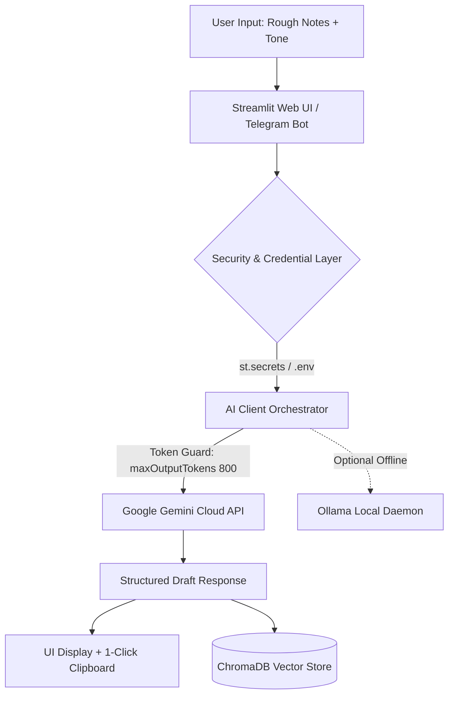
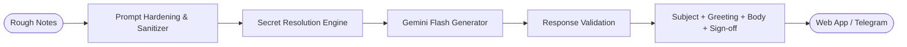

<div align="center">

# ⚡ S1000 AI Email Generator (v2.0)

[](https://s1000-email-generator.streamlit.app/)
[](https://www.python.org/downloads/)
[](https://ai.google.dev/)
[](https://opensource.org/licenses/MIT)

<br/>

```text
 ███████╗ ██╗ ██████╗  ██████╗  ██████╗ 
 ██╔════╝███║██╔═████╗██╔═████╗██╔═████╗
 ███████╗╚██║██║██╔██║██║██╔██║██║██╔██║
 ╚════██║ ██║████╔╝██║████╔╝██║████╔╝██║
 ███████║ ██║╚██████╔╝╚██████╔╝╚██████╔╝
 ╚══════╝ ╚═╝ ╚═════╝  ╚═════╝  ╚═════╝ 
```

**High-Speed Executive Communication Engine powered by Google Gemini & Streamlit**

### 🌐 Live Web Application: [s1000-email-generator.streamlit.app](https://s1000-email-generator.streamlit.app/)

</div>

---

## Overview

**S1000 AI Email Generator** is a production-grade communication suite that transforms unstructured thoughts, rough shorthand notes, and hurried bullet points into polished, executive-ready emails in seconds. 

Designed for busy professionals, founders, and engineers, S1000 combines cutting-edge **Google Gemini Flash** models with active token limit guardrails, vector context memory (RAG), and zero-leak credential security. Whether accessible via the interactive **Streamlit web dashboard** or on-the-go through the **Telegram Bot**, S1000 ensures high-impact email communication without ever hitting early token exhaustion.

---

## Key Features

- ⚡ **Live Cloud Intelligence**: Powered by Google's next-generation Gemini models (`gemini-2.5-flash`, `gemini-2.5-flash-lite`, `gemini-flash-latest`, `gemini-3.8-flash`).
- 🛡️ **Zero-Leak Background Security**: API keys are securely insulated in server-side memory via Streamlit Secrets and environment variables. Keys are never exposed to the frontend, browser inspect tools, or public git commits.
- 🎯 **7 Multi-Persona Tones**: Instantly switch personas to match any workplace context:
  - **Professional**: Formal executive style for high-stakes business communication.
  - **Polite**: Courteous and considerate style with high diplomacy.
  - **Assertive**: Decisive, clear expectations and firm boundaries.
  - **Friendly**: Warm, approachable, and relational.
  - **GenZ**: Modern, casual, and energetic.
  - **Casual**: Relaxed, conversational tone for internal banter.
  - **Brief**: Ultra-concise, TL;DR-style for fast decision-making.
- ⏱️ **Token Limit & Quota Protection**: Built-in `max_output_tokens: 800` budgeting, smart prompt truncation, and exponential backoff on HTTP 429 to prevent exhausting API limits.
- 🧠 **Context Memory (RAG)**: Self-healing **ChromaDB** vector integration to store and query email context history.
- 📋 **One-Click Clipboard**: Instant one-click copy button to paste drafts directly into Gmail, Outlook, or Slack.
- 🤖 **Omnichannel Telegram Bot**: Run the automated mobile bot to generate emails straight from your phone chat.
- 📧 **Gmail Thread Integration**: Optional IMAP/OAuth sync to fetch incoming threads and draft contextual replies.

---

## System Architecture

### Architectural Overview



### Execution Workflow



---

## Security & Secrets Management

S1000 enforces strict zero-leakage security principles:

1. **Server-Side Only**: The Gemini API key is loaded into backend memory via `st.secrets["GEMINI_API_KEY"]` on Streamlit Cloud or local environment variables.
2. **Hidden from Frontend**: No API keys are rendered in the HTML DOM, JavaScript bundles, or URL parameters.
3. **Repository Cleanliness**: `.streamlit/secrets.toml`, `.env`, and local credential files are strictly ignored by `.gitignore`.

---

## Supported AI Models

| Provider | Model | Latency | Token Efficiency | Recommended For |
| :--- | :--- | :--- | :--- | :--- |
| **Google Gemini** | `gemini-2.5-flash` | Ultra-fast (~0.8s) | High | **Default / Production** |
| **Google Gemini** | `gemini-2.5-flash-lite` | Instant (~0.4s) | Maximum (Highest RPM) | High-volume usage |
| **Google Gemini** | `gemini-flash-latest` | Ultra-fast (~0.8s) | High | Latest stable capabilities |
| **Google Gemini** | `gemini-3.1-flash-lite`| Fast (~0.9s) | High | Next-gen efficiency |
| **Google Gemini** | `gemini-3.8-flash` | Smart (~1.2s) | High | Complex reasoning & negotiation |
| **Ollama (Local)** | `llama3.1`, `mistral`| Local dependent | Local compute | 100% offline air-gapped environments |

---

## Setup & Installation

### Prerequisites
- Python 3.10 or higher
- Git installed on your system
- A Google Gemini API key (from [Google AI Studio](https://aistudio.google.com/))

### 1. Clone the Repository
```bash
git clone https://github.com/ShauryaVaid/S1000-Email-Generator-2.0-.git
cd S1000-Email-Generator-2.0-
```

### 2. Install Dependencies
```bash
pip install -r requirements.txt
```

### 3. Configure API Key
Create a `.streamlit/secrets.toml` file in the root directory (or set the `GEMINI_API_KEY` environment variable):
```toml
# .streamlit/secrets.toml (Kept local, never committed)
GEMINI_API_KEY = "your-gemini-api-key-here"
```

Alternatively, create a `.env` file:
```env
GEMINI_API_KEY=your-gemini-api-key-here
```

### 4. Launch the Application
```bash
streamlit run main.py
```
Open your browser at `http://localhost:8501`.

---

## Streamlit Cloud Deployment Guide

To deploy or update this application on [Streamlit Community Cloud](https://s1000-email-generator.streamlit.app/):

1. **Push your code to GitHub**:
   ```bash
   git add .
   git commit -m "Update S1000 Email Generator 2.0"
   git push origin main
   ```
2. **Configure Secrets on Streamlit Cloud**:
   - Go to your app dashboard at [share.streamlit.io](https://share.streamlit.io/).
   - Select the `s1000-email-generator` app.
   - Click **Settings** (⚙️) > **Secrets**.
   - Add your secret key:
     ```toml
     GEMINI_API_KEY = "your-api-key-here"
     ```
   - Click **Save**. The live site will automatically restart and begin serving requests securely!

---

## Project Structure

```text
S1000-Email-Generator-2.0-/
│
├── main.py                  # Streamlit frontend dashboard & application entry point
├── ai_client.py             # Resilient AI client with token control & rate-limit handling
├── chroma_manager.py        # Self-healing ChromaDB vector context storage
├── email_retriever.py       # IMAP & Gmail API thread retriever
├── telegram_bot.py          # Asynchronous Telegram bot implementation
├── config.yaml              # App configuration & default parameters
├── prompts.yaml             # Prompt templates and tone definitions
├── requirements.txt         # Production Python dependencies
├── .gitignore               # Strict security ignore rules
└── README.md                # Comprehensive documentation
```

---

## License

This project is licensed under the [MIT License](LICENSE).

<div align="center">
Built with ❤️ for seamless, lightning-fast professional communication.
</div>
